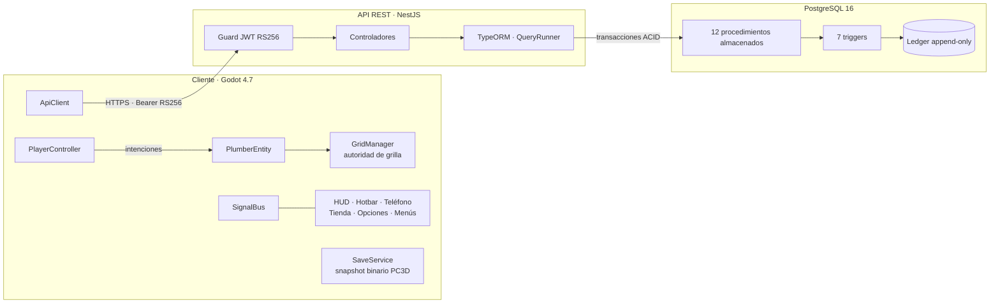

<div align="center">

# 🛠️ PipeCorp3D

**Simulador laboral 3D de gasfitería con arquitectura cliente-servidor, economía persistente y jurisdicción SISS**

*Portafolio de Título PTY4479 · Analista Programador Computacional · Duoc UC*


<br>


[Descripción](#-descripción) ·
[Novedades](#-novedades-v110-alpha) ·
[Arquitectura](#️-arquitectura) ·
[Controles](#-controles) ·
[Calidad](#-calidad) ·
[Metodología](#-metodología) ·
[Roadmap](#️-roadmap)

</div>

---

## 📖 Descripción

La formación de un gasfíter ocurre en terreno, donde cada error tiene un costo material, comercial y legal; intervenir la red pública está fiscalizado por la **Superintendencia de Servicios Sanitarios (SISS)**. **PipeCorp3D** permite practicar sin riesgo el ciclo completo de un trabajo: **plazo, instalación, costo y legalidad**.

El jugador dirige su propia PYME de gasfitería en primera persona:

1. Recibe trabajos (**tickets**) con temporizador en un teléfono virtual.
2. Acepta un trabajo y compra los materiales en una sola transacción.
3. Instala tuberías sobre una **grilla determinista de sockets**, eligiendo la pieza en la **hotbar**.
4. Recibe una **nota de S a F** y un pago calculados en el servidor.
5. Reinvierte en la **Tienda**: materiales y mejores vehículos (más capacidad de bodega).
6. Respeta la jurisdicción SISS: **derivar** un problema de la red pública otorga reputación; **intervenirla** genera multa y, ante reincidencia, un **Game Over irreversible**.

> **Principio de diseño:** el cliente solo expresa intenciones. Las reglas económicas y legales viven en PostgreSQL, por lo que ninguna capa cliente puede saltárselas.

---

## ✨ Novedades v1.1.0-alpha

> Versión técnica **ALPHA**: muestra el avance del sistema, no es un producto terminado.

| Versión | Módulo | Qué aporta |
|---|---|---|
| `v1.0.3` | **Menú de Opciones** | Pestañas Audio, Video, Controles y Juego desde el menú principal y la pausa. *Solo visual en ALPHA.* |
| `v1.0.4` | **Tienda y vehículos** | Compra de materiales y mejora de vehículo (A pie → Bicicleta → Hatchback → Furgón). Dinero, XP y capacidad validados por PostgreSQL. |
| `v1.0.5` | **Hotbar y teléfono** | Hotbar de 2 espacios (codo 90° / tubo recto) con rango de herramienta, y teléfono rediseñado con tarjetas por contrato. |
| `v1.1.0-alpha` | **HUD unificado** | Barra inferior con indicadores (dinero, XP, día, vehículo, tiempo) y teclas visibles, avisos en píldora y botón de término. |

Toda la interfaz comparte un mismo lenguaje visual: paneles oscuros redondeados, acentos por color (azul privado, rojo SISS, verde en curso, dorado selección) y montos en formato CLP (`$25.000`).

---

## 🏗️ Arquitectura



| Capa | Tecnología | Decisiones clave |
|---|---|---|
| **Persistencia autoritativa** | PostgreSQL 16 | 10 tablas normalizadas, 7 triggers y 12 procedimientos almacenados. Transacciones ACID con bloqueo de fila (`SELECT … FOR UPDATE`). **Ledger append-only**: el saldo siempre cuadra con la suma de movimientos. Capacidad de bodega por vehículo validada por trigger. |
| **API REST** | NestJS · TypeScript · TypeORM | JWT asimétrico **RS256** con lista blanca de algoritmos. Contraseñas con **scrypt**. Errores de negocio `PC001–PC007` traducidos a HTTP y mostrados en español en el cliente. |
| **Cliente** | Godot 4.7 · GDScript | Tipado estático estricto. Separación Input/lógica (`PlayerController` → `PlumberEntity`), base **MP-Ready**. La UI se comunica solo por `SignalBus` y se construye por código sobre escenas estables. |

<details>
<summary><b>Endpoints principales</b></summary>

| Método | Ruta | Descripción |
|---|---|---|
| `POST` | `/auth/register` · `/auth/login` | Registro e inicio de sesión (JWT RS256) |
| `GET` | `/profile` | Perfil autoritativo del jugador |
| `GET` | `/tickets` | Tablero de tickets |
| `POST` | `/tickets/:id/accept` · `/derive` · `/tampering` | Aceptar, derivar a la SISS o registrar intervención |
| `POST` | `/jobs/:id/complete` | Nota S–F y pago calculados en BD |
| `GET` · `POST` | `/inventory` · `/inventory/purchase` | Bodega del vehículo y compras |
| `POST` | `/vehicles/upgrade` · `/day/end` | Mejora de vehículo y cierre de día |

</details>

---

## 🎮 Controles

| Tecla | Acción |
|---|---|
| `W` `A` `S` `D` + mouse | Moverse y mirar |
| `Clic` | Instalar la pieza seleccionada en el socket apuntado |
| `1` `2` / rueda | Cambiar la pieza de la hotbar |
| `T` | Teléfono (contratos) |
| `B` | Tienda (materiales y vehículos) |
| `F` | Terminar el trabajo en curso |
| `C` | Cambiar de gasfíter (Player_1 ↔ Player_2) |
| `P` | Pausa (incluye Opciones) |
| `Esc` | Liberar el mouse / cerrar menús |

---

## 🧪 Calidad

**170 pruebas automatizadas aprobadas · 0 errores de typecheck.** Ninguna tarjeta pasa a *Done* sin su suite en verde y evidencia adjunta.

| Suite | Resultado |
|---|---|
| Base de datos: reglas SISS, economía y concurrencia | 15/15 |
| API: unitarias · autenticación · bucle de juego | 8/8 · 12/12 · 15/15 |
| Godot: núcleo (grilla, entidad, arquitectura) | 28/28 |
| Godot: integración cliente-servidor y guardado | 24/24 |
| Godot: humo de UI | 22/22 |
| Godot: zona SISS | 3/3 |
| Godot: menú de Opciones | 11/11 |
| Godot: Tienda y vehículos | 16/16 |
| Godot: Hotbar y teléfono | 16/16 |

Además, `Doctor` verifica scripts, clases, autoloads y el cableado de la escena principal (0 problemas).

---

## 📊 Metodología

Desarrollado con **Scrum** a partir de un Product Backlog derivado de la planificación de la Fase 1.

| Sprint | Fechas | Resultado |
|---|---|---|
| Sprint 1 | 21–27 sep 2026 | 22 / 22 pts |
| Sprint 2 | 28 sep–4 oct 2026 | 15 / 23 pts |
| Sprint 3 | 5 oct 2026 | 26 pts · MVP `v1.0.0` |
| **Sprint Alpha** | 11 oct 2026 | `v1.0.3` → `v1.1.0-alpha` |

- **GitFlow:** cada tarjeta de Trello en una rama `feature/*`, integrada a `develop` con `--no-ff`; cada versión pasa por `release/*` y se etiqueta en `main`.
- **Definition of Done:** tipado estricto sin advertencias, suites al 100 %, secretos fuera del repositorio y evidencia adjunta en Trello.

### Historial de versiones

| Versión | Contenido |
|---|---|
| `v1.1.0-alpha` | HUD unificado con indicadores y teclas; README de entrega |
| `v1.0.5` | Hotbar de 2 espacios y rediseño del teléfono |
| `v1.0.4` | Tienda de materiales y mejora de vehículos |
| `v1.0.3` | Menú de Opciones (visual) y etiqueta de versión |
| `v1.0.2` | README profesional |
| `v1.0.1` | Menú de pausa y correcciones de pruebas |
| `v1.0.0-mvp` | MVP jugable de punta a punta: 18 historias, 63 puntos |

---

## 🗺️ Roadmap

**Completado en el Sprint Alpha**

- [x] Interfaz de tienda y mejora de vehículos
- [x] Hotbar de 2 espacios (rango F visible)

**Próximo: v1.2**

- [ ] Opciones funcionales (audio, video y sensibilidad aplicados y guardados)
- [ ] Progresión de herramientas de rango F a S con efecto en la nota
- [ ] Sellado con llave y partículas de fuga
- [ ] Contratos desbloqueados por XP
- [ ] Cuentas independientes por gasfíter (multijugador real)
- [ ] Contenedor Docker para levantar base de datos y API con un comando

---

<details>
<summary><b>📁 Estructura del repositorio</b></summary>

```text
PipeCorp3D/
├── backend/     API REST NestJS
├── database/    Scripts SQL 01–05 (esquema, triggers, procedimientos, datos, pruebas)
└── godot/       Proyecto Godot
    ├── autoload/   SignalBus, GridManager, ApiClient, JobSession, SaveService
    ├── Scripts/    Núcleo, jugador, datos y mundo
    ├── UI/         HUD, hotbar, teléfono, tienda, opciones y menús
    ├── tests/      Pruebas headless, Doctor y API simulada
    └── World.tscn  Escena principal
```

</details>

## 👤 Autor

**Yolzer Awidan Saravia San Martín**
Analista Programador Computacional · Duoc UC
Docente guía: Alberto Campos Vidal

<sub>Proyecto académico desarrollado para el Portafolio de Título (PTY4479), octubre de 2026.</sub>
